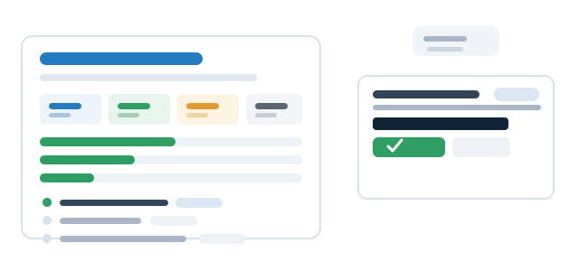

## v0.4.0 workbench IA

Six fixed tabs: Start Solving / Solving / Tools / Knowledge / Library Refinery / System Evolution. Knowledge merges the old overview, challenge ledger, detectors and lesson cards. Library Refinery (formerly Training) refines library assets only; System Evolution (formerly Self-Evolution) evolves the harness only. Ops: `/ctf-doctor [--json]` and structured `ctfpilot-ops.log` (JSONL).
